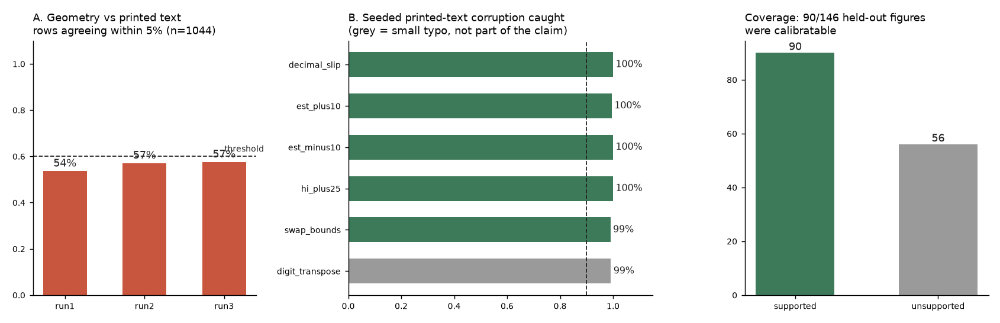

# ForestLens

**Verdict: PARTIAL.** ForestLens reads a forest plot twice - once from pixel geometry, once from the figure's own printed `HR [lo, hi]` column - and flags rows where the two disagree. On 146 held-out real CC-BY figures, geometry agreed with the printed text on **57.5%** of rows (pre-set target: 60% - missed). Seeded corruption of the printed text was caught **99.7%** of the time on rows the tool could read, but **42.5%** of unmodified rows are also flagged, so treat it as a noisy screen, not a digitiser. Full numbers: [EVAL-FINDINGS.md](EVAL-FINDINGS.md).


*Generated by `scripts/make_chart.py` from `eval_results.json`. Panel A shows all three runs (two fix attempts, neither reached the threshold).*

## What it does
```
image -> RapidOCR -> printed "est [lo, hi]" rows (regex)      \
                  -> numeric tick labels -> snap to drawn tick marks -> RANSAC log/linear axis fit (one per panel)
image -> classical CV per row: longest horizontal run = CI whisker/diamond, morphological-opening blob = marker
geometry values (via axis)  vs  printed values  ->  per-row flag if any |relative difference| > 5%
```
(5% is widened to half a unit in the last printed decimal when the text is coarser than that.)

## 30-second demo
```bash
pip install -r requirements.txt
python -m forestlens demo/real_forest_plot.webp --overlay out.png     # a real CC-BY figure: 6 rows, 0 flagged
python scripts/make_demo.py && python -m forestlens demo/synthetic_corrupted.png   # one printed value seeded wrong -> 1 flag
```
OCR on CPU takes ~10-30 s per figure. `python -m pytest -q` runs the synthetic-figure tests (~20 s). A `Dockerfile` is included (not built in the session that wrote it).

## Reproduce the eval
```bash
python scripts/fetch_corpus.py 160        # Europe PMC search + PMC S3 figure download (no keys)
python scripts/run_corpus.py test         # slow (OCR); resumable; first 15 manifest figures are the dev split
python scripts/eval.py myrun              # APPENDS to eval_results.json
python scripts/make_chart.py
```
`eval_results.json` is append-only; the first record is the ground-truth first run.

## Honest limits
- Ratio-scale (HR/OR/RR) rows with a printed text column only; 62% of held-out figures were calibratable.
- Weak on dense composites, tiny/light markers, plots whose big weighted square hides the CI, and figures whose tick labels are not truly log-spaced.
- Circularity: the printed text is both truth and cross-check, so the eval measures agreement and seeded-error recall, not accuracy on figures without text.
- Cut from the planned scope: the VLM-only baseline comparison (no VLM was run). No YOLO training (no box labels exist).

## Prior art (no paper was reproduced)
Not a reproduction of a published paper. Related tools found during validation: `beita6969/scienceclaw` "data-extractor" (VLM + OpenCV calibration across plot types; listing only, repo not inspected), `metaDigitise` (manual R digitiser), WebPlotDigitizer. Claimed here: forest-plot-specific, uses the figure's printed column as a self-check, ships a measured eval - not "first forest-plot extractor".

## Data and licence
Corpus figures come from CC-BY PMC articles (`data/manifest.json` lists PMCID/caption); images are re-downloaded by `fetch_corpus.py` and not committed, except one attributed demo figure (`demo/ATTRIBUTION.md`).
